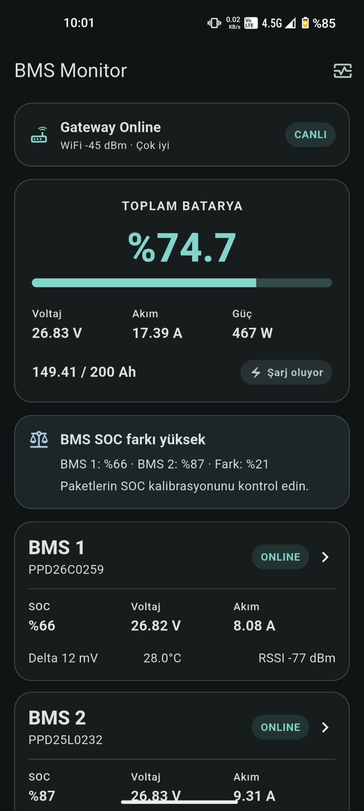
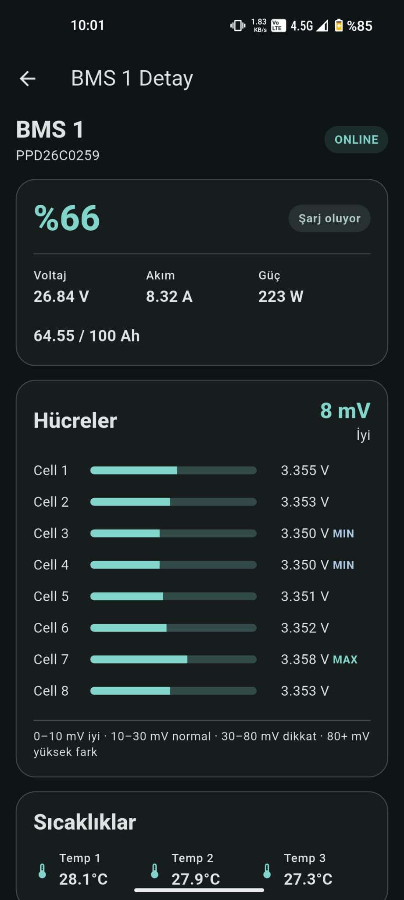
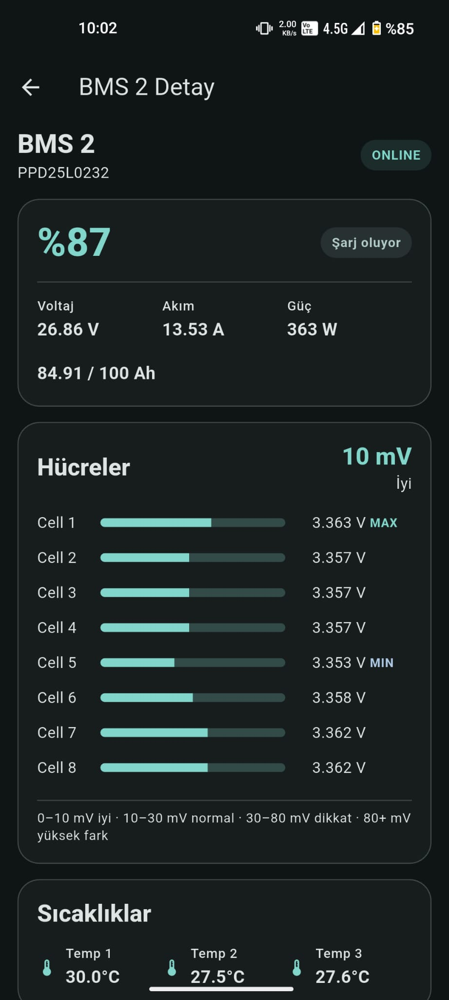
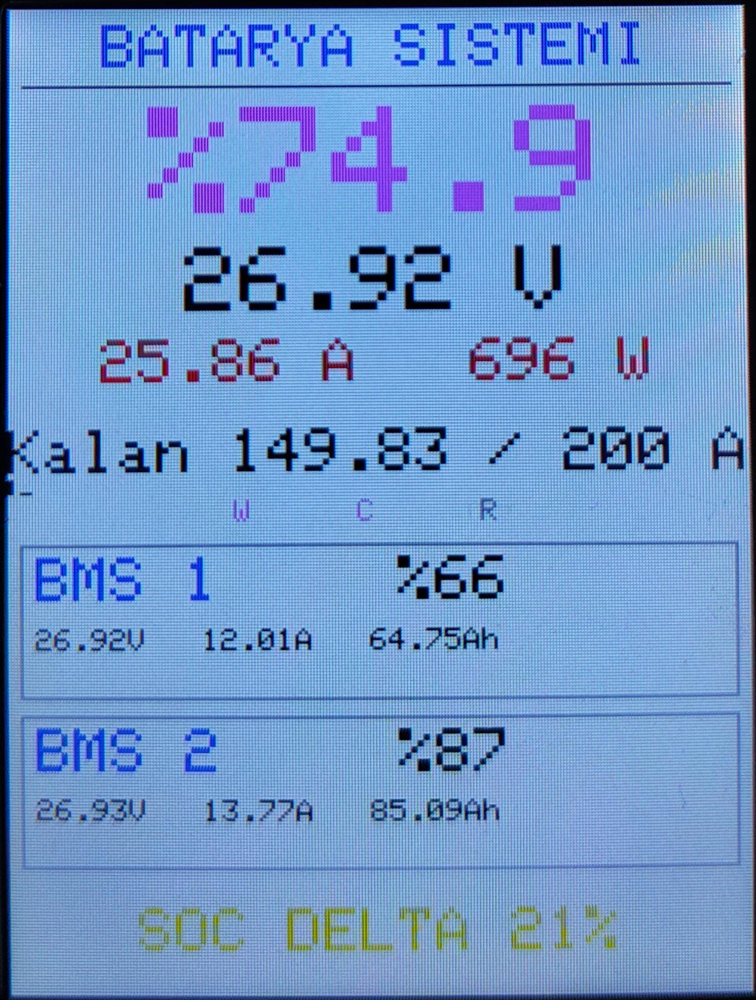
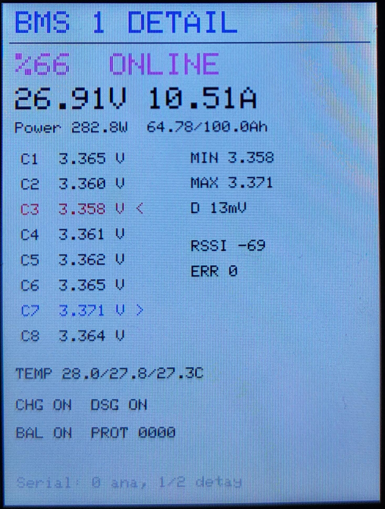
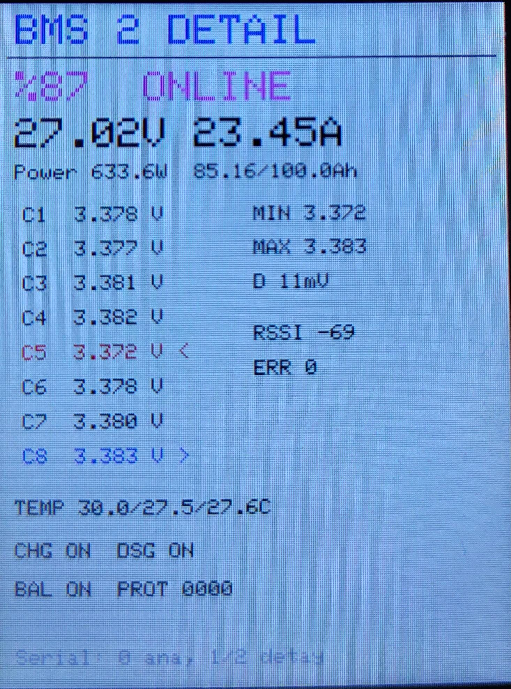

# ESP32 BMS Gateway & Flutter Monitor

An open-source battery monitoring system that discovers JBD/Jiabaida-compatible Bluetooth BMS devices through an ESP32, displays their data on a local TFT dashboard, and publishes remote live telemetry to a Flutter mobile application through Firebase Realtime Database.

## Features

### ESP32 Gateway

- Discovers and tracks up to 12 JBD/Jiabaida-compatible BMS devices over BLE
- Keeps up to three links active; larger fleets rotate automatically in groups of three
- Reads pack voltage, current, SOC, remaining capacity, and temperatures
- Reads individual cell voltages
- Calculates minimum/maximum cell voltage and cell delta
- Reads charge/discharge MOS and balancing states
- Local 2.8-inch TFT dashboard
- Wi-Fi connectivity and automatic reconnect
- Firebase Authentication and Realtime Database integration
- Viewer-controlled live telemetry
- Gateway status heartbeat

### Flutter Mobile App

- Firebase Email/Password Authentication
- Real-time system battery dashboard
- Gateway online/offline detection based on timestamp freshness
- Live, delayed, stale, and offline telemetry states
- Dynamic BMS list and separate detail screens for every discovered battery
- Individual cell voltage visualization
- SOC mismatch warnings
- BMS temperature, MOS, balancing, protection, and RSSI monitoring
- One-shot 60-second remote monitoring sessions
- Material 3 and system dark mode

## Architecture

```text
┌──────────────┐                         ┌──────────────┐
│ JBD BMS #1…3 │                         │ JBD BMS #4…N │
└──────┬───────┘                         └──────┬───────┘
       │ BLE                                    │ BLE
       └────────────────┐      ┌────────────────┘
                        ▼      ▼
                  ┌────────────────┐
                  │ ESP32 Gateway  │──────► 2.8" TFT
                  └───────┬────────┘
                          │ Wi-Fi
                          ▼
                 ┌──────────────────────┐
                 │ Firebase Realtime DB │
                 └──────────┬───────────┘
                            │
                            ▼
                 ┌──────────────────────┐
                 │ Flutter Mobile App   │
                 └──────────────────────┘
```

## Tested Hardware

- ESP32-32E
- 2.8-inch 240x320 TFT LCD
- ST7789P3 display controller
- XPT2046 resistive touch controller
- 2x Lexron 25.6V 100Ah LiFePO4 batteries
- JBD-compatible Bluetooth BMS

## ESP32 Pin Mapping

The following mapping was tested on the current board revision. Touch calibration may differ between revisions.

```text
TFT CS    = GPIO15
TFT DC    = GPIO2
TFT SCK   = GPIO14
TFT MOSI  = GPIO13
TFT MISO  = GPIO12
TFT BL    = GPIO21

Touch SCK  = GPIO25
Touch MOSI = GPIO32
Touch MISO = GPIO39
Touch CS   = GPIO33
Touch IRQ  = GPIO36
```

## JBD BLE Protocol

The firmware uses the following services and registers commonly exposed by JBD/Jiabaida-compatible BMS devices. Three or fewer devices remain connected concurrently; four or more are polled in rotating groups of three and their last fresh readings remain visible in Firebase and the mobile app.

```text
Service:     FF00
Notify/Read: FF01
Write:       FF02

Basic Info register: 0x03
Cell Info register:  0x04
```

## Repository Structure

```text
.
├── esp32/
│   ├── src/
│   ├── include/
│   ├── firebase/
│   ├── docs/
│   └── platformio.ini
├── mobile/
│   ├── lib/
│   ├── test/
│   ├── android/
│   ├── ios/
│   └── pubspec.yaml
├── docs/
│   └── images/
├── .gitignore
├── LICENSE
└── README.md
```

## ESP32 Setup

```bash
git clone https://github.com/ramazang0kmen/BMSMonitor.git
cd BMSMonitor/esp32
```

Create the local secrets file.

Linux/macOS:

```bash
cp include/config/Secrets.example.h include/config/Secrets.h
```

Windows PowerShell:

```powershell
Copy-Item include/config/Secrets.example.h include/config/Secrets.h
```

Fill the Wi-Fi and Firebase values in `include/config/Secrets.h`. Never commit this file.

```bash
pio run
pio run -t upload
pio device monitor -b 115200
```

## Firebase Setup

1. Create a Firebase project.
2. Enable Realtime Database.
3. Enable Authentication > Email/Password.
4. Create a dedicated ESP32 device user.
5. Create a separate mobile user.
6. Add the Database URL, API key, device email, and device password to `Secrets.h`.
7. Apply authenticated and role-restricted RTDB rules.

Each device uses `devices/{deviceId}/` with these child nodes:

```text
status/
control/
live/
```

The claim-based rules template is in `esp32/firebase/database.rules.json`. Assign the `gateway` and `viewer` custom claims from a trusted Admin SDK environment before deployment, and review `mobile/docs/FIREBASE_RULES_RECOMMENDATION.md` for details.

## Session-Controlled Telemetry

When the Flutter application opens or returns to the foreground, it writes one Firebase server timestamp to `devices/{deviceId}/control/remoteSession/requestedAt`. The ESP32 detects the request and enables live telemetry for 60 seconds.

After 60 seconds, live telemetry uploads automatically stop without deleting the last `live/` snapshot. Opening or resuming the app, or pressing the manual **1 dk canlı izle** action, starts another 60-second monitoring window. The app does not periodically renew a session while it remains in the foreground, and the status heartbeat remains independent.

## Mobile Setup

```bash
cd mobile
flutter pub get
```

Register new Android and iOS Firebase applications with this package/bundle identifier:

```text
com.ramazangokmen.bmsmonitor
```

Then generate the native Firebase configuration:

```bash
flutterfire configure \
  --project=YOUR_FIREBASE_PROJECT_ID \
  --platforms=android,ios
```

Run the application:

```bash
flutter run
```

The ESP32 device account must not be used for mobile login. Create a separate Firebase Authentication account for each mobile user.

> **Security:** Never embed the ESP32 device account credentials in the Flutter application.

## RTDB Data Example

```json
{
  "bms": {
    "bms_a5c23a20e51f": {
      "id": "bms_a5c23a20e51f",
      "order": 0,
      "name": "PPD26C0259",
      "online": true,
      "connected": true,
      "lastSeen": 1787944736309,
      "voltage": 26.31,
      "soc": 37.0
    }
  },
  "system": {
    "voltage": 26.31,
    "current": 0.0,
    "power": 0.0,
    "soc": 32.62,
    "remainingAh": 65.24,
    "totalCapacityAh": 200.0
  }
}
```

## Security

- `Secrets.h` is ignored by Git.
- Never commit Wi-Fi passwords or Firebase device credentials.
- RTDB must never use public read/write rules.
- Mobile users should only read telemetry and write remote session requests.
- The gateway identity should be the only identity allowed to write `status` and `live`.
- Production deployments should use stricter UID or custom-claims-based rules.

## Current Limitations

- Touch panel calibration may vary between board revisions.
- Current sign convention should be verified under real charging/discharging load.
- SOC accuracy depends on the BMS coulomb counter and calibration.
- The remote session request uses one shared `requestedAt` field.
- Production Firebase rules require device/user role separation.

## Project Status

- ESP32 BLE dual-BMS communication: Working
- Local TFT dashboard: Working
- Wi-Fi/Firebase RTDB: Working
- Viewer-controlled live telemetry: Working
- Flutter application: Implemented
- Unit tests: Passing
- Real-device mobile end-to-end validation: Recommended

## Screenshots

### Flutter Mobile App

| System dashboard | BMS 1 details | BMS 2 details |
|:---:|:---:|:---:|
|  |  |  |

### ESP32 TFT Display

| System dashboard | BMS 1 details | BMS 2 details |
|:---:|:---:|:---:|
|  |  |  |

## License

Released under the MIT License. See `LICENSE`.
